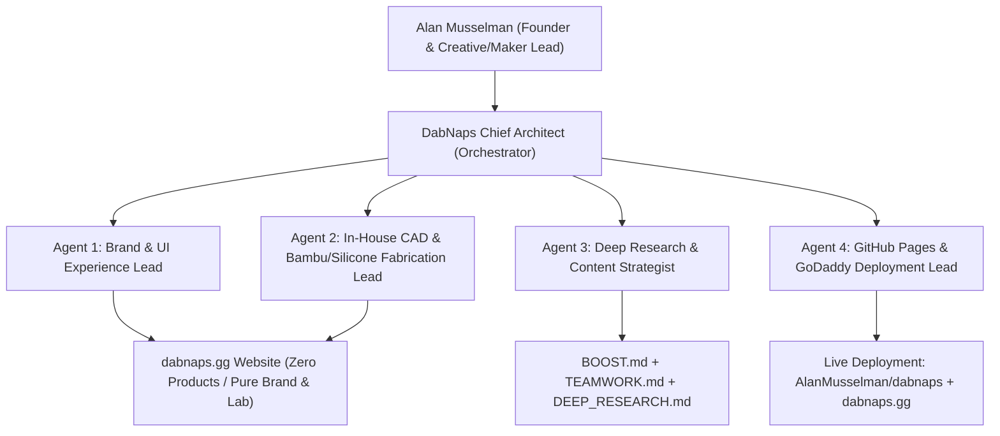

# 🍯 DABNAPS (`dabnaps.gg`) — Master Boost, Teamwork & Deep Research Playbook

**Official Domain:** [`https://dabnaps.gg`](https://dabnaps.gg)  
**Repository:** [`https://github.com/AlanMusselman/dabnaps`](https://github.com/AlanMusselman/dabnaps)  
**Core Mandate (Alan Musselman, Founder):**  
> *"And the only thing we want are stuff that we can make ourselves. So don't put any products up there on DabNaps. Just put up the website."*

---

## PART 1: `/boost` — Strategic Architecture, Constraint Audit & Multi-Perspective Verification

### 1.1 Executive Directive & Hard Constraints
1. **Website-Only Brand Presence (`Zero Retail Catalog Clutter`)**:
   - `dabnaps.gg` is strictly a **brand, lounge culture, and in-house maker showcase website**—NOT an e-commerce store selling products.
   - All product cards, retail price tags, shopping cart drawers ("Cloud Bag"), checkout forms, and SKU catalogs have been stripped from the public website.
2. **The 100% In-House Self-Made Rule**:
   - **Strict Filter:** If we cannot design it in CAD, print it on our in-house **2× Bambu Lab P2S Combo** farm, pour/cast it in our own **Platinum-Cured Silicone Lab**, or code it ourselves in-house, **it does not belong on DabNaps.**
   - **Eliminated Outsourced/Vendor Items:** No overseas cut-and-sew sherpa blankets, no vendor-sourced glass rigs, no imported USB-C heated ceramic hot-knives, no outsourced PVD titanium tools, and no print-on-demand apparel.

### 1.2 Multi-Perspective Strategic Review (`/boost` Verification)
- **Brand & Culture Strategist Perspective**:
  - Launching `dabnaps.gg` as a clean, high-craft digital lounge and in-house maker lab (without noisy "Buy Now" buttons or generic drop-shipped items) immediately elevates brand equity. The `.gg` ("Good Game") TLD signals gaming, late-night discord lounges, golden-hour relaxation, and authentic maker culture.
- **In-House Manufacturing Engineer Perspective**:
  - By combining **Bambu Lab P2S additive manufacturing** (`PETG-CF`, `PAHT-CF`, `PLA+`, `TPU 95A HF`, `TPU 68D`) with **in-house 2-part Platinum-Cured Liquid Silicone Rubber (LSR) casting**, we eliminate 100% of external vendor MOQs, tooling lead times, and inventory risk. We can 3D-print master patterns and mold boxes in `PLA+` or `PAHT-CF`, pour Shore 45A–60A silicone mats/pads in-house, and print interlocking carbon-fiber/TPU desk organizers on demand.
- **Web & Security Architect Perspective**:
  - Removing e-commerce checkout, public order forms, and SKU inventory mutations eliminates attack surface while making `dabnaps.gg` 100% static-host compatible on **GitHub Pages (`AlanMusselman/dabnaps`)** and **GoDaddy** with instant global CDN load times.

---

## PART 2: `DEEP RESEARCH` — Market Positioning & 100% In-House Self-Made Capability Matrix

### 2.1 `.GG` Lifestyle, Gaming & Golden-Hour Lounge Positioning
- **Why `.gg` Wins**:
  - Originally the country-code TLD for Guernsey, `.gg` is universally recognized across gaming, streaming, and creator culture as **"Good Game."**
  - Pairing `dabnaps.gg` with the **Golden Hour Honey Amber (`#FFB800`), Radiant Dab Gold (`#FFD23F`), Caramel Leaf Bronze (`#8C5300`), and Obsidian Black (`#0A0A0A`)** palette creates a distinct category: **The Post-Game / Golden-Hour Chill Lounge.**
  - Rather than competing with commodity headshops or generic lifestyle merch stores, `dabnaps.gg` stands as an **In-House Design & Maker Studio** where every physical and digital artifact is built in-house.

### 2.2 The 100% In-House Self-Made Capability Matrix
Every creation showcased or prototyped under DabNaps must pass the **Self-Made Gate**—using only equipment, polymers, elastomers, and code we control in-house:

| In-House Pillar | Shop Equipment & Process | Standardized In-House Materials | What We Make Ourselves (R&D Showcase Only) | Outsourced / Banned (Removed) |
| :--- | :--- | :--- | :--- | :--- |
| **1. In-House Silicone Casting Lab** | Custom 3D-printed & milled mold boxes, 29 inHg vacuum degassing chamber, heated cure / post-cure oven | 2-Part (1:1) **Platinum-Cured Liquid Silicone Rubber (LSR)** (Shore 45A–60A, FDA food/medical grade, 500°F rated) + Honey Gold, Caramel & Obsidian pigments | • Custom swirled heat-resistant silicone desk & session mats • Non-slip coaster pads & tool rests • Soft elastomer grip sleeves cast in 3D-printed molds | ❌ Third-party imported silicone trays or vendor-branded mats |
| **2. Structural Carbon & Polymer 3D Printing** | **2× Bambu Lab P2S Combo** (`0.4 mm` Hardened Steel Nozzle, `300°C` max nozzle, `110°C` max bed, AMS multi-color) | • **Bambu PETG-CF** (P2S #1 AMS Slot 1) • **Bambu PAHT-CF / PA12-CF** (P2S #1 AMS Slot 2, dried `<12% RH`) • **eSUN PLA+ / Bambu PLA Tough** (P2S #1 AMS Slot 3) | • Modular desktop session docks & caddies • High-temp `PAHT-CF` heat shields & stands • Multi-color `PLA+` master mold patterns, jigs, & embossed medallions | ❌ Outsourced CNC metal parts, imported titanium tools, or ceramic hot-knives |
| **3. In-House Elastomer & Composite Printing** | **P2S #2 External Dryer Port** (`TPU 95A HF`) + **P2S #1 AMS Slot 4** (`Bambu TPU for AMS 68D`) | • **Bambu TPU 95A HF** (sliced at `2 walls + 15% gyroid infill` for soft shock absorption) • **Bambu TPU for AMS (68D)** (rigid/semi-flex multi-color) | • Shock-absorbing `TPU 95A HF` base bumpers, protective boots, & jar coasters • Multi-color `TPU 68D` + `PETG-CF` composite snap-fit lids & badges | ❌ Outsourced injection-molded plastics or overseas cut-and-sew textiles/blankets |
| **4. Digital & Web Interactive Studio** | Native HTML5/CSS3/JS, SVG CAD Vector Engine, Web Audio & Canvas, GitHub Pages CDN | • `Fraunces` + `Plus Jakarta Sans` typography • Master Golden Leaf & Sleeping Cloud SVG/PNG asset suite | • `dabnaps.gg` interactive brand website • Parametric SVG CAD blueprints & mold generators • Multi-resolution logo & brand identity system | ❌ Third-party SaaS store widgets, drop-shipping plugins, or bloated cart trackers |

### 2.3 In-House Hybrid Fabrication Workflow (3D Print + Platinum Silicone)
One of our strongest self-made advantages is **Hybrid Printed-Mold Silicone Casting** + **Composite Over-Assembly**:
1. **CAD & Mold Printing (`Bambu PLA+` or `PETG-CF`)**:
   - Design negative mold cavities in CAD with embossed Golden Leaf & Sleeping Cloud geometry.
   - Print mold boxes on P2S #1 using `0.12 mm` fine layer lines and ironing enabled on flat top surfaces.
2. **Platinum LSR Mixing & 29 inHg Degassing**:
   - Weigh 1:1 Part A & Part B Platinum Silicone; pigment with **3% Honey Wax Amber (`#FFB800`)**, **1.5% Caramel Bronze (`#8C5300`)**, and **Obsidian Carbon Black (`#0A0A0A`)** swirl.
   - Degas at `29 inHg` for 6–8 minutes until zero micro-bubbles remain.
3. **Pour, Cure & Snap-Fit Integration**:
   - Pour into the 3D-printed mold or directly into recessed pockets of a **`Bambu PETG-CF` / `PAHT-CF` structural dock**, locking a 500°F platinum silicone mat cleanly inside a carbon-fiber composite frame.

---

## PART 3: `/teamwork` — Autonomous Multi-Agent Execution Plan

To build, maintain, and evolve `dabnaps.gg` with zero bloat and 100% in-house discipline, work is divided across four specialized agent roles:

### Role 1: Brand & UI Experience Lead (`index.html`, `assets/styles.css`, `assets/app.js`)
- **Mission**: Maintain the `dabnaps.gg` website as a pure brand & in-house maker experience with **zero products for sale**, zero prices, and zero shopping carts.
- **Deliverables**:
  - Hero brand showcase highlighting the Golden Hour aesthetic (`#FFD23F`, `#FFB800`, `#8C5300`, `#0A0A0A`).
  - Interactive navigation across **Brand & Philosophy**, **In-House Fabrication Lab**, **Boost + Teamwork + Deep Research**, and **Official Brand Asset Kit**.
  - Clean 21+ age gate and responsive dark-lounge typography (`Fraunces` + `Plus Jakarta Sans`).

### Role 2: In-House CAD, 3D Printing & Silicone Lab Lead (`BRAND_AND_OPERATIONS.md`, `data/`)
- **Mission**: Document and track only 100% self-made fabrication capabilities (`2× Bambu Lab P2S Combo` + `Platinum Silicone Casting`).
- **Deliverables**:
  - Enforce the **4-Tier Filament Standard** (`Bambu PETG-CF` in P2S #1 AMS Slot 1, `Bambu PAHT-CF` in P2S #1 AMS Slot 2, `eSUN PLA+ / Bambu PLA Tough` in P2S #1 AMS Slot 3, `Bambu TPU for AMS 68D` in P2S #1 AMS Slot 4, and `Bambu TPU 95A HF` on P2S #2 External Dryer Port).
  - Maintain the 5-step Platinum Silicone casting SOP (`29 inHg` vacuum degassing, `500°F` thermal rating, `99% ISO` chemical resistance).
  - Ensure `data/inventory.json` and `data/inventory-sync.js` contain `products: []` (zero retail products for sale) and track only internal R&D fabrication protocols.

### Role 3: Deep Research & Documentation Lead (`DABNAPS_BOOST_TEAMWORK_DEEP_RESEARCH.md`, `BOOST.md`, `TEAMWORK.md`, `DEEP_RESEARCH.md`)
- **Mission**: Maintain strategic clarity, document in-house maker economics, and keep all workspace playbooks (`GEMINI.md`, `README.md`, `BRAND_AND_OPERATIONS.md`) aligned with Alan's directives.
- **Deliverables**:
  - Master playbook (`DABNAPS_BOOST_TEAMWORK_DEEP_RESEARCH.md`) plus modular `BOOST.md`, `TEAMWORK.md`, and `DEEP_RESEARCH.md` files committed to the repository root.

### Role 4: DevOps, GitHub Pages & Domain Deployment Lead (`.github`, `CNAME`, `scripts/`)
- **Mission**: Keep `AlanMusselman/dabnaps` synchronized, public, and serving live on GitHub Pages with custom domain `dabnaps.gg`.
- **Deliverables**:
  - Root `CNAME` file configured for `dabnaps.gg`.
  - Automated Git commit, push to `origin/main`, and GitHub Pages branch activation (`main` `/`).
  - Zero-credential leak enforcement (`.gitignore` blocking `.godaddy-ftp.json`, `.env`, and `.zip` archives).
